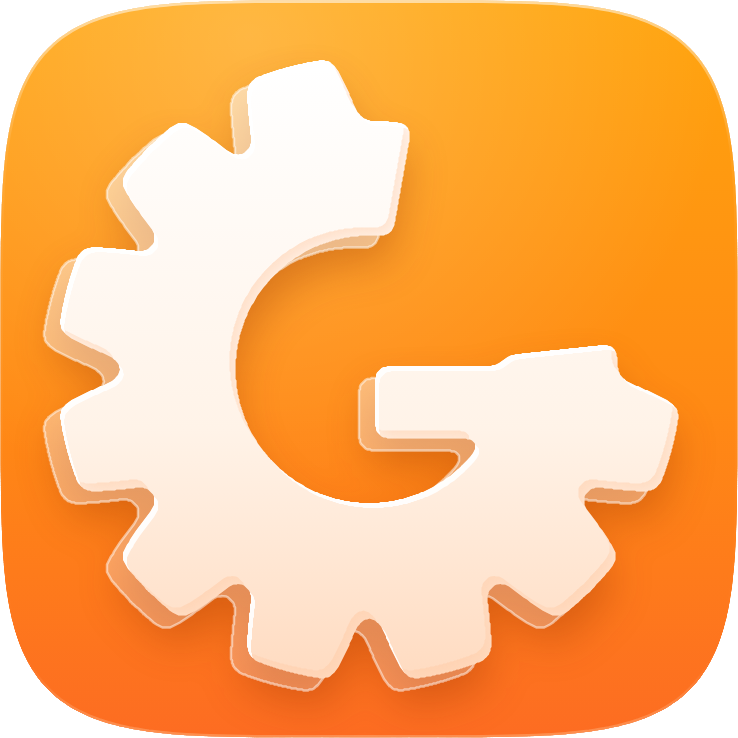
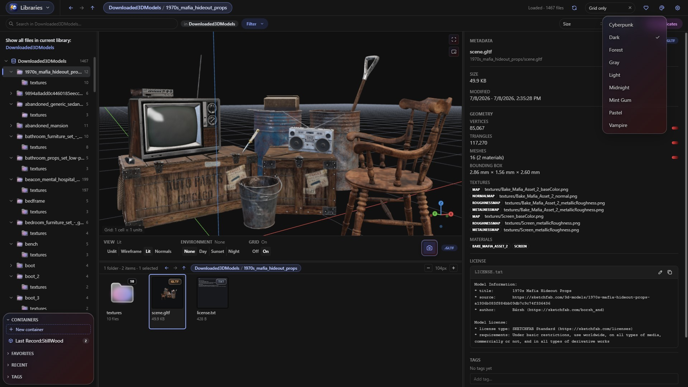

<p align="center">
  
</p>

<h1 align="center">Game Asset Manager</h1>

<p align="center">
  <b>A desktop app for browsing, previewing, organizing and exporting game development assets in one place.</b><br>
  3D models, images, audio, video and text in one library, with fast thumbnails, a real 3D viewer and a compact mini mode. Offline, open source.
</p>

<p align="center">
  
  
  
  
  
</p>

<p align="center">
  <a href="#features">Features</a> ·
  <a href="#supported-file-formats">Formats</a> ·
  <a href="#get-started">Get started</a> ·
  <a href="#keyboard-shortcuts">Shortcuts</a> ·
  <a href="#known-issues">Known issues</a> ·
  <a href="#developer-guide">Developer guide</a> ·
  <a href="#credits">Credits</a>
</p>

<br>

<p align="center">
  
  <br>
  <sub>The main window: folders on the left, thumbnails in the middle, preview and metadata on the right.</sub>
</p>

> Originally forked from [mthorson](https://github.com/mthorson)'s [stl-sherpa](https://github.com/mthorson/stl-sherpa) by [iam-aydin](https://github.com/iam-aydin), then restructured as **Game Asset Manager** to focus on game asset organization and workflow management.

<br>

<table>
  <tr>
    <td width="25%" valign="top">
      <h3>🧊 Real 3D preview</h3>
      Orbit or WASD-fly through models with lighting presets, HDRI, wireframe and normals views.
    </td>
    <td width="25%" valign="top">
      <h3>🔎 Fast search</h3>
      Search names, tags and metadata. Save any filter as a Smart Collection.
    </td>
    <td width="25%" valign="top">
      <h3>🗂️ Safe organizing</h3>
      Move, rename and batch-rename with undo. Models travel with their textures.
    </td>
    <td width="25%" valign="top">
      <h3>🎵 Built-in players</h3>
      Audio with EQ, pitch shift and waveform. Video with subtitles, tools and optional Anime4K upscaling.
    </td>
  </tr>
</table>

<br>

## Supported file formats

| Category | Formats |
|---|---|
| **3D models** | `.fbx` `.gltf` `.glb` `.obj` `.stl` `.ply` `.3mf` |
| **Images** | `.png` `.jpg` `.jpeg` `.bmp` `.ico` `.svg` |
| **Audio** | `.wav` `.mp3` `.flac` |
| **Video** | `.mp4` `.mov` `.avi` `.webm` `.mkv` `.bik` |
| **Text & documents** | `.txt` `.md` `.ini` `.html` |

Preview and metadata availability depend on the format and on what each file contains.

<br>

## Features

### 🎮 Interactive 3D viewport
Preview 3D assets inside your library without opening another app.

- **WASD navigation:** `W` / `S` zoom, `A` / `D` pan sideways, `Shift + W/S` move vertically. Orbit with the mouse, axis gizmo, grid and automatic framing.
- **View modes:** Lit, Unlit, Wireframe, Normals.
- **Lighting presets:** five presets, plus **HDRI** environments with an adjust popover.
- **Render quality:** four tiers (Low, Medium, High, Ultra) for shadows and texture sharpness. Anti-aliasing: Auto, Off, FXAA, SMAA, MSAA.
- **Custom thumbnails:** capture your preferred camera angle as the asset thumbnail.
- **Orientation overrides:** per-file rotation fix for models that import the wrong way up.
- Supports glTF spec-gloss, multipart 3MF, and checks archives for unsafe zip content.
- **Print helpers:** mm or inch units, a **fits-my-bed** check against your printer sizes (rotation allowed) and a **print-cost estimate** from your material costs.

### 📊 Detailed asset metadata
For supported 3D models the metadata panel shows:

- File size and modification date.
- Vertex and triangle counts, mesh counts.
- Bounding box dimensions.
- Material names and material information.
- Referenced textures and their paths.
- License information when available. A `license.txt` next to a file is shown in a card with Edit and Copy buttons.

### 🔎 Search & filtering
- **Fast search** across file names, tags and supported metadata.
- **File-type filters** for 3D, image, audio, video and text, with **match counts**.
- **Triage facets** to narrow a big library quickly.
- **Folder navigation:** folder tree, Back, Forward, Up and breadcrumbs.
- **Grid and list views**, with zoom.
- **Sorting** by size, modification date and other properties.
- **Customizable columns:** show, hide and reorder file-list columns. Choices are saved between sessions.

### 🏷️ Asset organization
- **Hierarchical tags**, for example `characters/heroes/hero_01`, with a tags sidebar, bulk tag editing and bulk metadata.
- **Ratings** 1–5 and **color labels** (`Ctrl/Cmd + 1–5`).
- **Smart Collections:** save search text, extensions, tags, minimum rating and color labels as a rule set.
- **Collections**, **Favorites** and **Recent assets**.
- **Folder context menus** for common file and folder operations.
- **Compare** two files side by side.

### 🎵 Built-in audio player
- **Three-band equalizer:** Sub Bass, Bass, Treble, in real time.
- **Pitch shifting** up to ±12 semitones for sound design testing.
- **Waveform** overlay on the seek bar.
- Cover art, audio output device selection, and smooth browsing of collections with hundreds of files.

### 🎬 Video preview
- Plays `.mp4`, `.mov`, `.avi`, `.webm`, `.mkv` (and `.bik` through a fallback path): game cinematics, animation references, trailers.
- Embedded subtitles with font choices, speed control, volume, context menu and fullscreen.
- **Anime4K upscaler (optional):** on GPUs with WebGPU, upscale anime and cartoon footage in real time (Settings menu > Upscale). Off by default and can be heavy on the GPU.

**Video tools** (use the ffmpeg that ships with the app):

| Tool | What it does |
|---|---|
| **Audio** | Save the video's sound as its own file (original, MP3, WAV, FLAC, M4A, Opus) |
| **No audio** | Copy without sound, instant and lossless |
| **Convert** | MP4, WebM, MKV or GIF with H.264 / H.265 / AV1, CPU or NVIDIA encoding |
| **Compress** | Shrink to a target size, with presets for Discord, email and web |
| **Frame** | Save the current frame as a PNG |

### 🖼️ Image & text viewers
- **Image preview** for images and textures.
- **Text viewer**, **Markdown viewer** for project notes, and **`.ini`** configuration files.
- **HTML preview** for `.html` files. JavaScript does not run in it yet (see [Known issues](#known-issues)).

### 🪟 Compact / mini mode
- A smaller window you can keep next to other apps, such as Unreal Engine, Blender or other creative tools.
- Audio and video previews, plus the sound and video effects, work in the compact window.

### 📦 File management & export
- **Drag and drop** files between folders.
- **Duplicate** (`Ctrl/Cmd + D`), **batch rename** with a template, and **Undo** (`Ctrl/Cmd + Z`) for moves and renames. Deletes go to the Trash with a "Show in Trash" toast.
- **Containers:** finds everything a model needs (textures, buffers, materials) and plans a move or copy first, so nothing is left behind.
- **ZIP archives** and **collection exports**, to a destination you choose, with related textures, buffers, materials and license files included when available.
- **Contact sheets** for visual browsing and sharing.
- **Open with…** menu for Blender, Unreal Engine, Photoshop, slicers and others. Set a default per extension, pass args with `{file}` and `{profile}`, and keep named slicer profiles.

### 📚 Library management
- Open any **folder as a library**. Changes on disk are picked up by a file watcher. Network drives are polled, with an adjustable interval.
- Reuse **registered library locations** when importing library data, or pick a new one.
- Thumbnails are rendered in the background, so you can browse right away.

### 🎨 Interface & updates
- **Nine themes:** Dark, Light, Gray, Midnight, Forest, Mint Gum, Pastel, Vampire, Cyberpunk, chosen from a theme selector.
- Rebindable shortcuts that work in any keyboard language, and theme-aware file and folder indicators.
- **Built-in update checker**, plus an **About** tab with app info and the project's GitHub page.

<br>

## Get started

1. Start the app and **open a folder as a library**.
2. Browse while thumbnails generate. Click a file to preview it.
3. `Space` for fullscreen preview, `1`–`5` to rate, `Ctrl/Cmd + 1–5` for color labels.
4. Right-click for tags, move, rename, open with, export and more.

### Your data
- Each library has a **`.Gam.db`** SQLite database at the root of its folder and a unique UUID.
- Machine-specific paths live in the app's user-data folder:
  - **macOS:** `~/Library/Application Support/gam/`
  - **Windows:** `%APPDATA%/gam/`
- `libraries.json` maps library UUIDs to local paths. Moving a library to another machine may need a reconnect.
- `preferences.json` holds global settings: units, external app routes, NAS polling interval, render quality, print beds and costs.
- Your asset files change only when you move, rename or delete them from inside the app.

<br>

## Keyboard shortcuts

| Action | Keys |
|---|---|
| Back / Forward / Up | `Alt+←` or `Backspace` / `Alt+→` / `Alt+↑` |
| Previous / Next file | `←` / `→` |
| Fullscreen preview | `Space` |
| Rating | `0`–`5` |
| Color label | `Ctrl/Cmd + 0–5` |
| Copy / Cut / Paste | `Ctrl/Cmd + C` / `X` / `V` |
| Duplicate | `Ctrl/Cmd + D` |
| New folder | `Ctrl/Cmd + Shift + N` |
| Delete | `Delete` |
| Undo | `Ctrl/Cmd + Z` |
| Hide interface (players) | `H` |

Players have their own keys: `Space` play / pause, `A` / `D` seek, `W` / `X` volume, `M` mute, `J` / `K` / `L` speed, `F` fullscreen.

<br>

## ⚠️ Performance notes
The first scan of a large library can make the app lag or look stuck. Let it finish before assuming a crash.

- **Under about 1,000 files:** usually smooth.
- **Thousands of files:** initial setup takes longer and may hang for a while.
- Initial loading performance is being investigated and improved.

## 🐛 Known issues
- **HTML preview:** JavaScript does not run.
- **Large libraries:** the first load can cause temporary lag or hangs.
- **Thumbnail disk usage:** thumbnails are 512x512 by default and take a lot of space on big libraries. Patch 4 will lower the default and make it adjustable.
- Undo covers moves and renames only.

Found something else? Report it through the project's GitHub repository.

<br>

# 🛠️ Developer guide

## Architecture
Built with **Electron**, **React**, **Mantine UI** and **Three.js**, in three layers:

1. **Main process:** SQLite via `better-sqlite3`, file watching via `chokidar`, external app launching, the thumbnail worker queue.
2. **Renderer process:** React UI, app state, audio engine, Three.js viewport.
3. **Thumbnail workers:** hidden `BrowserWindow`s that render 3D models into PNG thumbnails in the background.

Custom protocols used by the renderer:

- `wh3d-thumb://` serves the thumbnail cache.
- `wh3d-file://` streams 3D, audio and image data straight from disk.

## Run locally
```sh
npm install
npm run dev
```
`npm install` rebuilds `better-sqlite3` for Electron's Node ABI through a `postinstall` script.

```sh
npm run test:full   # tests, with native module rebuild for system Node
npm run typecheck   # TypeScript check
npm run build       # compile renderer and main bundles
```

## Package & release
Uses `electron-builder`. Output goes to `release/`.

```sh
npm run dist         # current OS
npm run dist:mac     # macOS DMG and ZIP (arm64, x64)
npm run dist:win     # Windows NSIS installer (x64)
npm run dist:linux   # Linux AppImage (x64)
npm run build:icon   # regenerate icon PNGs from the source SVG
```

## Project structure
```text
src/
  main/
    db/             SQLite wrapper, migrations, repositories
    libraries/      Library registry and attachment lifecycle
    scanner/        Filesystem walker and watcher
    thumb-pool/     Background thumbnail queue, ffmpeg frames
    containers/     Find and plan moves of a model plus its textures
    preferences/    Preferences read/write
    cache/          Thumbnail cache management
    undo/           Undo queue for moves and renames
    ipc/            Typed IPC handlers
    protocol/       Custom thumbnail and asset protocols
  renderer/
    components/     Panels, modals, viewports, media widgets
    three/          Model viewer, lighting, HDRI, loaders, view modes
    themes/         The nine themes
    util/           React hooks and formatters
  preload/          Context bridge IPC API
  shared/           Shared utilities, paths, types, queries
```

<br>

## Credits
- **[mthorson](https://github.com/mthorson)** for the original [stl-sherpa](https://github.com/mthorson/stl-sherpa) this app was forked from.
- **[Anime4K](https://github.com/bloc97/Anime4K)** by bloc97 (MIT), the real-time upscaling algorithm.
- **[Anime4K-WebGPU](https://github.com/Anime4KWebBoost/Anime4K-WebGPU)** by Ruijun (Daniel) Zhong, Tong Hu and Yuanqi Wang (MIT), the WebGPU port used for the upscaler.
- The open-source libraries in `package.json`, including Electron, React, Mantine, Three.js, ffmpeg and better-sqlite3.

Full license texts for bundled third-party code: [THIRD-PARTY-NOTICES.md](THIRD-PARTY-NOTICES.md).

## 💬 Feedback & contributions
Bug, feature request or want to contribute? Find the repository through [iam-aydin's GitHub profile](https://github.com/iam-aydin) and open an issue.

## License
See [LICENSE](LICENSE).
