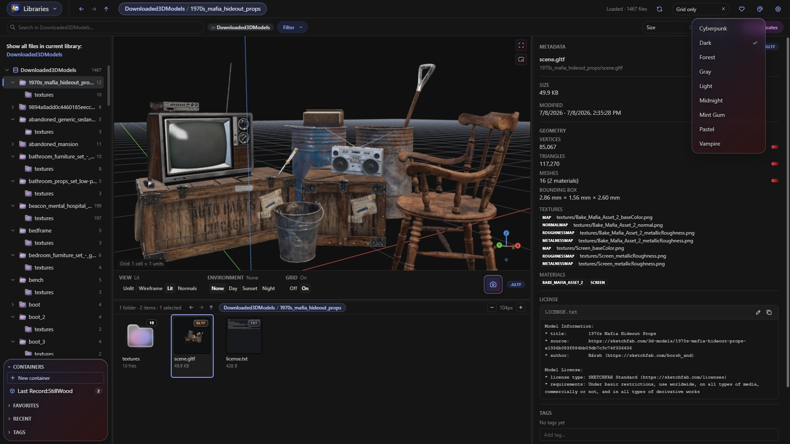

# Game Asset Manager



> Originally forked from [mthorson](https://github.com/mthorson) by [iam-aydin](https://github.com/iam-aydin), then restructured as **Game Asset Manager** to focus specifically on game asset organization and workflow management.

A desktop application for browsing, previewing, organizing, and managing game development assets in one place. Explore 3D models, inspect asset metadata, preview audio and video, organize your library, and export assets through a unified workspace.

---

## 📋 Supported File Formats

| Category | Supported formats |
|---|---|
| **3D Models** | `.fbx`, `.gltf`, `.glb`, `.obj`, `.stl`, `.ply`, `.3mf` |
| **Images** | `.png`, `.jpg`, `.jpeg`, `.bmp` |
| **Audio** | `.wav`, `.mp3`, `.flac` |
| **Video** | `.mp4`, `.mov`, `.avi`, `.webm`, `.mkv` |
| **Text & Documents** | `.txt`, `.md`, `.ini`, `.html` |

Preview and metadata availability may vary depending on the file format and the information contained in each asset.

---

## ✨ Features

### 🎮 Interactive 3D Viewport

Preview 3D assets directly inside your library without needing to open another application.

- **WASD Navigation:** Use `W` and `S` to zoom, `A` and `D` to pan horizontally, and `Shift + W/S` to move vertically.
- **Lighting Presets:** Choose from five lighting presets to inspect your models under different lighting conditions.
- **Render Quality:** Select from four quality tiers.
- **Custom Thumbnails:** Capture your preferred camera angle as an asset thumbnail.
- **Orientation Overrides:** Apply per-file rotation corrections to models that import in the wrong orientation.
- **Viewport Visualization:** Access available visualization modes, including wireframe and normals.
- **Environment Controls:** Adjust viewport environment settings when examining models.

### 📊 Detailed Asset Metadata

Inspect useful information about your assets directly in the metadata panel.

For supported 3D models, available information includes:

- File size and modification date.
- Vertex and triangle counts.
- Mesh counts and material information.
- Bounding box dimensions.
- Referenced textures and their paths.
- Material names.
- Associated license information when available.

This makes it easier to inspect downloaded assets, understand their geometry, and locate resources associated with a model.

### 🔎 Search & Filtering

Find assets in your library using search and filtering tools.

- **Fast Search:** Search file names, tags, and supported metadata.
- **File-Type Filters:** Filter assets by supported 3D, image, audio, video, and text formats.
- **Match Counts:** See how many assets match your current filters.
- **Folder Navigation:** Browse nested folders using the folder tree and navigation controls.
- **Grid & List Views:** Switch between visual browsing and detailed file lists.
- **Sorting:** Sort files by available properties, such as size and modification date.
- **Customizable Columns:** Show, hide, and reorder file-list columns, with preferences saved between sessions.

### 🏷️ Asset Organization

Keep your asset collection organized as it grows.

- **Hierarchical Tags:** Organize assets using nested tags, such as `characters/heroes/hero_01`.
- **Ratings & Labels:** Assign star ratings from 1–5 and use color labels with `Ctrl/Cmd + 1–5`.
- **Smart Collections:** Save custom search queries and filter combinations.
- **Favorites:** Keep frequently used assets easy to access.
- **Recent Assets:** Return to recently accessed content.
- **Folder Context Menus:** Access common file and folder operations directly from the library browser.

### 🎵 Built-In Audio Player

Preview and inspect supported audio files directly in Game Asset Manager.

- **Three-Band Equalizer:** Adjust Sub Bass, Bass, and Treble in real time.
- **Pitch Shifting:** Adjust pitch by up to ±12 semitones for sound design testing.
- **Waveform Visualization:** View waveform overlays on the audio seek bar.
- **Large Audio Collections:** Browse and play collections containing hundreds of audio files.

### 🎬 Video Preview

Preview supported video assets directly within the application.

Supported formats include:

- `.mp4`
- `.mov`
- `.avi`
- `.webm`
- `.mkv`

Video previews make it easier to browse game cinematics, animation references, trailers, and other video assets alongside the rest of your library.

### 🖼️ Image & Text Viewers

- **Image Preview:** Inspect supported images and textures directly in the application.
- **Text Viewer:** Read text files without leaving your library.
- **Markdown Viewer:** View project notes and Markdown documentation.
- **Configuration Files:** Open supported `.ini` files.
- **HTML Preview:** Preview supported `.html` files. JavaScript execution in the HTML preview is currently not working.

### 🪟 Compact / Mini Mode

Use the compact window mode to keep previews accessible without occupying your entire screen.

- **Compact Window:** Switch to a smaller window for working alongside other applications.
- **Media Previews:** Access supported preview experiences, including audio and video, in the compact workflow.
- **Sound & Video Effects:** Access supported media effects while working with previews.
- **Multitasking:** Keep asset previews close while working in tools such as Unreal Engine, Blender, or other creative applications.

### 📦 File Management & Export

Manage files and move assets through your workflow.

- **Drag and Drop:** Move files between folders using drag and drop.
- **Duplicate Files:** Duplicate selected files with `Ctrl/Cmd + D`.
- **Batch Renaming:** Rename multiple files in one operation.
- **ZIP Archives:** Compress assets into ZIP archives.
- **Collection Exports:** Export collections using the ZIP export workflow.
- **Custom Export Destination:** Choose where exported archives are saved.
- **Related Asset Files:** Include associated textures, buffers, materials, and license files when available.
- **Contact Sheets:** Generate contact-sheet exports for visual asset browsing.
- **External Applications:** Configure an "Open With..." menu for tools such as Blender, Unreal Engine, Photoshop, and other applications.

### 📚 Library Management

Organize assets around folders that matter to your workflow.

- **Folder-Based Libraries:** Open folders as libraries and browse their contents.
- **Saved Library Locations:** Reuse registered library locations when importing library data.
- **Custom Library Locations:** Select a new location when needed.
- **Library Navigation:** Move between folders using Back, Forward, Up, and Breadcrumb controls.
- **Folder Tree:** Explore nested directories from the sidebar.
- **Containers:** Access and organize assets using the available container features.

### 🎨 Interface Customization

Customize the interface to suit your workspace.

- **Dark & Light Themes:** Choose from available dark and light themes.
- **Theme Selector:** Browse themes through an organized selection interface.
- **Saved Preferences:** Retain supported interface and file-list settings between sessions.
- **Adaptive Visuals:** Browse files and folders with theme-aware visual indicators.

### 🔄 Update Checking

- **Built-In Update Checker:** Check for available application updates directly from the app.
- **About Tab:** Access application information and the project's GitHub page.

---

## ⚠️ Performance Notes

Game Asset Manager may experience temporary lag or become unresponsive while processing your first large library.

- **Smaller Libraries:** Libraries with fewer than approximately 1,000 files should generally be more manageable during initial loading.
- **Large Libraries:** Libraries containing thousands of files may take longer to process and can cause temporary hangs during initial setup.
- **Performance Improvements:** Initial library-loading performance is being actively investigated and improved.

If the application appears temporarily stuck during initial processing, allow it some time to finish before assuming it has crashed.

---

## 🐛 Known Issues

- **3D Camera Navigation:** Keyboard zooming may move the camera inside certain meshes.
- **Audio Waveform Rendering:** Thumbnails may occasionally appear instead of waveforms when switching between asset types.
- **HTML JavaScript Execution:** JavaScript does not currently work in the HTML preview.
- **Large Library Initialization:** Processing a large library for the first time may cause temporary lag or hangs.

If you encounter an issue, please report it through the project's GitHub repository.

---

# 🛠️ Developer Guide

## Architecture Overview

Game Asset Manager is built with **Electron**, **React**, **Mantine UI**, and **Three.js**.

The application is organized into three main process layers:

1. **Main Process:** Manages the SQLite database through `better-sqlite3`, filesystem watching through `chokidar`, external application execution, and the thumbnail worker queue.
2. **Renderer Process:** Manages the React interface, application state, audio engine, and Three.js 3D viewport.
3. **Thumbnail Workers:** Hidden `BrowserWindow` instances that render 3D models into PNG thumbnails in the background.

The renderer communicates with the main process and accesses assets through custom protocols:

- `wh3d-thumb://` — Handles thumbnail cache delivery.
- `wh3d-file://` — Streams supported 3D, audio, and image asset data directly from disk.

---

## How Libraries Work

Opening a folder as a library creates a `.meshFlask.db` SQLite database at the root of that folder. Each library is associated with a unique UUID.

Machine-specific library mount paths are stored in the application's user data directory.

- **macOS:** `~/Library/Application Support/meshFlask/`
- **Windows:** `%APPDATA%/meshFlask/`

### Configuration Files

- `libraries.json` — Maps library UUIDs to their local filesystem paths. Moving a library to another machine may require reconnecting it to its new location.
- `preferences.json` — Stores global application settings, including units, external application routes, NAS polling intervals, and render quality.

---

## Running Locally

Make sure Node.js and npm are installed, then run:

```sh
npm install
npm run dev
```

> **Native modules:** `npm install` automatically rebuilds `better-sqlite3` against Electron's Node ABI through a `postinstall` script.

### Running Tests

Use the full test script to handle native module rebuilding for tests running in system Node:

```sh
npm run test:full
```

### Other Commands

```sh
npm run typecheck
npm run build
```

- `npm run typecheck` — Runs TypeScript type verification.
- `npm run build` — Compiles the renderer and main-process bundles without modifying native modules.

---

## Packaging & Releases

Build standalone application packages using `electron-builder`:

```sh
npm run dist        # Build for the current OS
npm run dist:mac    # macOS DMG and ZIP (arm64 and x64)
npm run dist:win    # Windows NSIS installer (x64)
npm run dist:linux  # Linux AppImage (x64)
```

Build outputs are placed in `release/`.

To regenerate application icon PNGs from the source SVG:

```sh
npm run build:icon
```

---

## Project Structure

```text
src/
  main/
    db/             SQLite wrapper, migrations, repositories
    libraries/      Library registry and attachment lifecycle
    scanner/        Filesystem walker and watcher
    thumb-pool/     Background thumbnail rendering queue
    preferences/    Preferences read/write handlers
    cache/          Thumbnail cache management
    ipc/            Typed IPC handlers
    protocol/       Custom thumbnail and asset protocols
  renderer/
    components/     Panels, modals, viewports, and media widgets
    three/          Model viewer, lighting, and model loaders
    util/           Custom React hooks and formatters
  preload/          Context bridge IPC API
  shared/           Shared utilities, paths, types, and queries
```

---

## 💬 Feedback & Contributions

Found a bug, have a feature request, or want to contribute? Visit [iam-aydin's GitHub profile](https://github.com/iam-aydin) to locate the repository and share your feedback.

Game Asset Manager aims to make game asset organization, previewing, and everyday development workflows easier through one unified desktop application.
